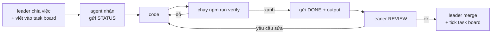

# ROLE — Hiến pháp dự án Nhịp

> File này là **nguồn sự thật duy nhất** về dự án và về cách các agent làm việc với nhau.
> Mọi agent đọc file này **trước khi làm bất cứ việc gì**. Nếu thấy nội dung ở đây mâu thuẫn
> với trí nhớ của mình, **file này thắng** — trí nhớ của agent có thể cũ, file thì không.
>
> Cập nhật file này là việc của `leader`. Agent khác đề xuất qua `CHAT.md`, không tự sửa.

---

## 1. Dự án là gì — để không lệch

**Nhịp** là hạ tầng để một nền tảng trả tiền cho người lao động **trong vài giây**, thay vì giam tiền 7 ngày.

- **Chạy trên:** Arc (Circle L1). Chain ID mainnet `5042`, testnet `5042002`.
- **Tiền:** chỉ USDC. Không token khác, không multi-currency trong MVP.
- **Mô hình:** B2B SaaS tính theo số payout. Không lấy % dòng tiền.
- **Không giữ tiền.** Tiền đi từ ví nền tảng tới ví người lao động. Nhịp là phần mềm, không phải tổ chức trung gian thanh toán.

**Luận điểm duy nhất phải bảo vệ trong mọi quyết định:**

```
Trả 5.000 người/ngày
  Ethereum L1 : ~$12.600  (437% của một đơn 15.000đ)
  Arc         : ~$3       (0,1%)
```

Nếu một tính năng làm mất lợi thế này (ví dụ: thêm một bước gọi contract đắt, hoặc chuyển sang chain khác), tính năng đó sai — bất kể nó hay đến đâu.

**Người dùng:**
- **Người mua:** vận hành nền tảng gig, 100–5.000 lao động. Không quan tâm blockchain.
- **Người nhận:** lao động gig. Cần tiền về nhanh, không cần hiểu "gas".

Chi tiết đầy đủ: `docs/specs/nhip-mvp.md` (phạm vi lát cắt hiện tại) và plan gốc (artifact `nhip-master-plan.md`).

---

## 2. Bất biến kỹ thuật — luật cứng, không thương lượng

Vi phạm một điều dưới đây là **blocker**, không phải "nit". `scripts/lint-guards.mjs` chặn tự động.

| # | Luật | Vì sao |
|---|---|---|
| **B1** | Mọi số tiền là `bigint` brand `Micro`, đơn vị 1e-6 USDC. Trong JSON là **string**. | `number` mất chính xác trên 2^53. Float trên tiền là bug, không phải style |
| **B2** | **Cấm** `parseUnits(x, 18)` cho USDC. **Cấm** alias `0xEeee…EEeE`. | USDC trên Arc là 6 decimals ở interface ERC-20. Nhầm thành 18 là sai 10¹² lần |
| **B3** | **Cấm** gửi tới `address(0)`. Validate trước khi vào hàng đợi. | Trên Arc, gửi zero address **revert**; trên Ethereum thì không |
| **B4** | `maxFeePerGas` phải ≥ **20 Gwei** (sàn của Arc). | Dưới sàn → tx treo vô hạn, cả lô không được trả |
| **B5** | Không endpoint nào chờ chain. Ghi nhận rồi trả `202`. | Nền tảng không được bị chặn bởi tốc độ chain |
| **B6** | Trạng thái `unknown` **không bao giờ** được tự retry. | Blocklist revert trên Arc tiêu gas mà không sinh receipt. Retry mù = trả trùng |
| **B7** | Idempotency là ràng buộc **ở DB** (`UNIQUE`), không phải ở code. | Code có thể race; unique index thì không |
| **B8** | Chain là source of truth. Postgres là read model, dựng lại được từ block 0. | Indexer chết không được làm mất dữ liệu thật |
| **B9** | UI **không bao giờ** hiển thị `0` thay cho trạng thái lỗi/chưa tải. Lỗi → `—` + thông báo. | Người vận hành thấy "0 đã trả" sẽ tưởng đã trả xong và đi về |
| **B10** | Mọi phép tính tiền ở client dùng `BigInt` trên chuỗi micro. Cấm `Number(`, `parseFloat`, `* 1e6` trên đường tiền. | Cùng lý do B1, nhưng ở tầng không có typecheck |

---

## 3. Quyền sở hữu file

**Một file chỉ có đúng một chủ.** Muốn sửa file của người khác → gửi `HANDOFF` trong `CHAT.md` và chờ `ACK`. Không sửa lén.

| Vai | Sở hữu | Không được chạm |
|---|---|---|
| `leader` | `ROLE.md`, `CHAT.md`, `DESIGN.md`, `docs/tasks/`, `docs/specs/`, `package.json`, `tsconfig.json` | code trong `packages/`, `apps/` |
| `core-dev` | `packages/core/` | `apps/`, `packages/db/` |
| `db-dev` | `packages/db/`, `scripts/seed.ts` | `apps/` |
| `api-dev` | `apps/api/` | `packages/core/` (chỉ đọc) |
| `web-dev` | `apps/web/` | `apps/api/` (chỉ đọc, cần endpoint mới thì `HANDOFF`) |
| `qa` | `tests/`, `e2e/`, `scripts/verify-*.mjs` | code sản phẩm (chỉ đọc và báo lỗi) |

> `apps/web` từng không có chủ. Đó là lý do `api-dev` phải tự dựng dashboard trong `msg-0016`
> — việc đúng nhưng sai vai. Từ `msg-0020`, `apps/web` thuộc `web-dev`.

`scripts/lint-guards.mjs` và `scripts/team-check.mjs` thuộc `leader` — vì chúng định nghĩa luật.

Kiểm tra xung đột: `npm run team:check`.

---

## 4. Năm vai

Mỗi vai có một card riêng trong `.agents/roles/`. Card chứa: nhiệm vụ, đầu vào, đầu ra, và điều kiện bàn giao.

| Vai | Một câu |
|---|---|
| `leader` | Giữ dự án không lệch, chia việc, gỡ chặn, merge, là người duy nhất được sửa task board |
| `core-dev` | Domain thuần: tiền, địa chỉ, chia lô. Không I/O, không HTTP, không DB |
| `db-dev` | Schema, migration, truy vấn. Ràng buộc đúng đắn nằm ở DB chứ không ở code |
| `api-dev` | HTTP layer. Nhận request, validate, gọi core, ghi DB, trả 202 |
| `web-dev` | Giao diện: landing + dashboard. Đọc API thật, không bịa số, tiền bằng `BigInt` |
| `qa` | Bẻ gãy sản phẩm trước khi người dùng làm. Không sửa code, chỉ chứng minh lỗi |

---

## 5. Giao thức liên lạc — `CHAT.md`

`CHAT.md` là **nhóm chat chung**, append-only. Không xoá tin cũ. Không sửa tin đã gửi (nếu sai thì gửi tin mới nói rõ).

### Định dạng một tin (bắt buộc, có thể parse máy)

```md
## msg-0007 · 2026-10-27T09:12+07:00 · api-dev → leader · STATUS · re:T7

Nội dung. Ngắn, cụ thể, có số.
```

Bảy loại tin:

| Loại | Dùng khi | Bắt buộc có |
|---|---|---|
| `STATUS` | Báo tiến độ, **mỗi lượt làm việc** | Việc đang làm, đã xong gì, còn gì |
| `ASK` | Cần quyết định hoặc thông tin | Câu hỏi đóng, có phương án A/B |
| `BLOCK` | Không làm tiếp được | Chặn bởi ai/việc gì, cần gì để gỡ |
| `HANDOFF` | Cần người khác sửa file mình không sở hữu, **hoặc cần phối hợp 2 agent** | File, lý do, kỳ vọng, deadline |
| `DONE` | Xong một task | **Lệnh verify + output thật** |
| `DECIDE` | Chốt một quyết định (chỉ `leader`) | Quyết định, lý do, ảnh hưởng |
| `REVIEW` | Yêu cầu review trước khi merge | Diff hoặc file, checklist |

### Ba luật của nhóm chat

1. **Không im lặng.** Agent làm việc mà không có tin `STATUS` trong lượt đó = coi như không làm.
2. **`DONE` phải có bằng chứng.** Không có output lệnh = chưa xong. Đây là luật của `AGENTS.md`, áp dụng nguyên vẹn.
3. **Chặn thì phải nói `BLOCK` ngay**, không ngồi đoán. Đoán mò rồi báo xong là lỗi nặng nhất.

### Khi nào được gọi agent khác

Được gọi khi **cả ba** đúng:

- Cần sửa file mình không sở hữu, **hoặc**
- Cần hai phần ghép lại mới verify được (ví dụ: API + core phải chạy cùng nhau), **hoặc**
- Phát hiện một bất biến ở mục 2 bị vi phạm ở phần của người khác.

Không được gọi để: hỏi việc đã có trong `ROLE.md`; xin ý kiến thẩm mỹ; hoặc "cho chắc".

**Cách trả lời một `HANDOFF`:** người nhận gửi lại `STATUS` nêu rõ nhận hay không nhận.
Không nhận thì là `BLOCK` kèm lý do. Không có phản hồi thì việc đó **chưa được nhận** —
người gửi phải tự làm hoặc escalate.

> Không có loại tin `ACK`. Bảy loại tin ở bảng trên là danh sách đóng;
> `scripts/team-check.mjs` từ chối mọi loại khác.

---

## 6. Vòng đời một task



Không nhảy bước. Không có `DONE` trước khi `verify` xanh.

---

## 7. Định nghĩa "xong"

Một task xong khi **tất cả** đúng:

- [ ] `npm run verify` xanh (lint + typecheck + test), output thật được trích trong tin `DONE`
- [ ] Có test mới hoặc test cũ chứng minh hành vi mới
- [ ] Không vi phạm B1–B8
- [ ] Không `TODO`, không mock data giả, không `console.log` debug
- [ ] File của người khác không bị sửa (hoặc có `HANDOFF` + `ACK`)
- [ ] Nêu rõ phần **chưa** làm

---

## 8. Điều cấm

- Cấm sửa file ngoài quyền sở hữu mà không có `HANDOFF`.
- Cấm `DONE` khi `verify` đỏ.
- Cấm sửa test để test pass, trừ khi test sai thật và có giải thích trong `CHAT.md`.
- Cấm sửa `ROLE.md` (chỉ `leader`).
- Cấm xoá tin trong `CHAT.md`.
- Cấm tự retry trạng thái `unknown`.
- Cấm commit secret, `RELAYER_PRIVATE_KEY`, hay bất kỳ khoá nào.

---

## 9. Escalation

| Tình huống | Làm gì |
|---|---|
| Hai agent cùng muốn sửa một file | `HANDOFF` cho `leader`, leader quyết |
| Spec không nói tới, việc nhỏ | Tự quyết, ghi `GIẢ ĐỊNH:` trong tin `DONE` |
| Spec không nói tới, việc khó revert | `ASK` cho `leader`, chờ trả lời |
| Phát hiện lỗi trong `ROLE.md` | `ASK` cho `leader` kèm đề xuất sửa |
| Phát hiện rủi ro mất tiền | `BLOCK` ngay, tag `leader`, không tự sửa |

---

## 10. Lệnh dùng hằng ngày

```bash
npm run verify      # lint + typecheck + test — chạy trước mọi DONE
npm run team:check  # kiểm ROLE.md, role cards, CHAT.md, xung đột sở hữu
npm run team:board  # in trạng thái task hiện tại
```
